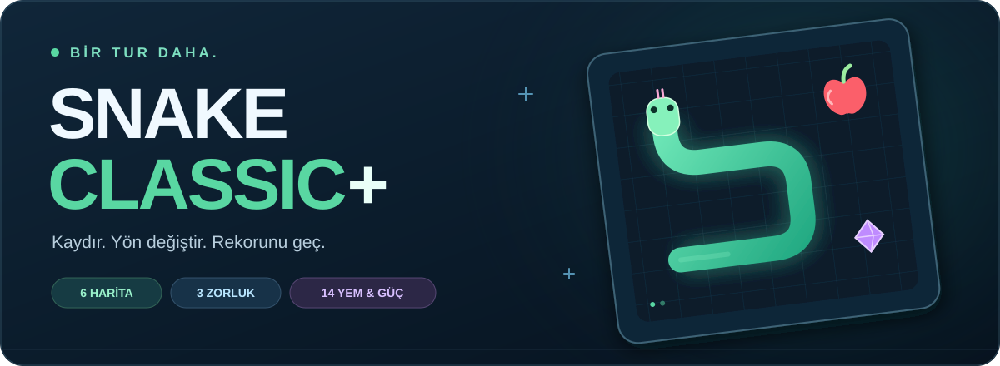
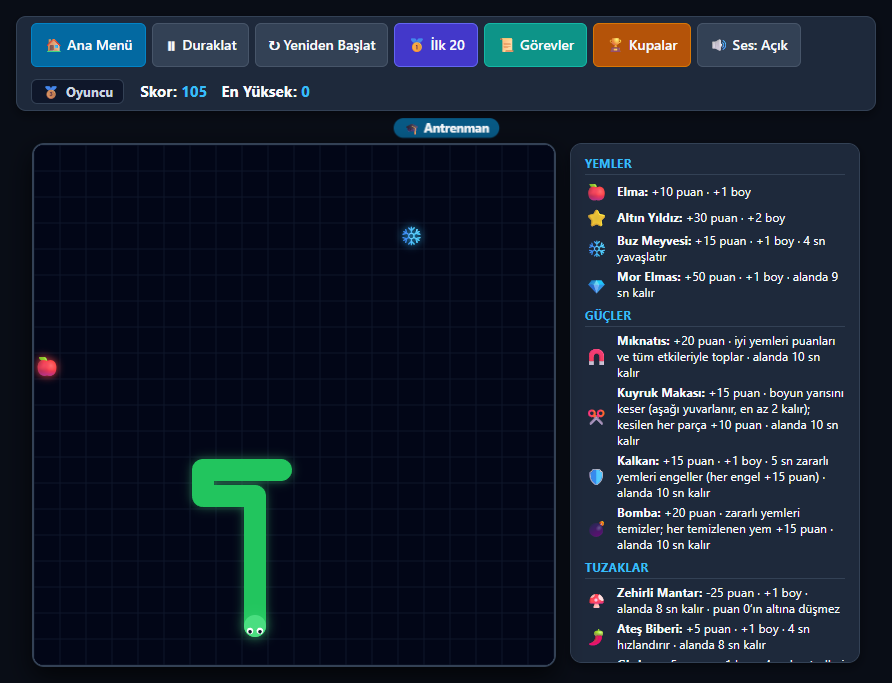
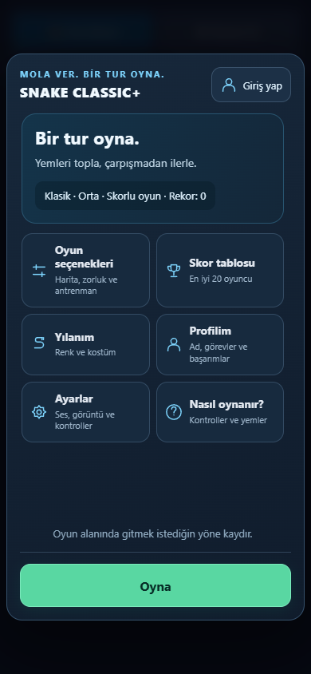
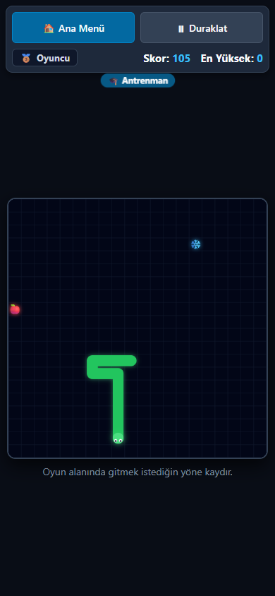

<p align="center">
  <a href="https://snake-classic-plus.yusufzkal.chatgpt.site/">
    
  </a>
</p>

<p align="center">
  Klasik yılan oyunu; özel güçler, farklı haritalar ve sana ait bir rekorla.
  <br>
  <strong>Telefonda kaydır. Bilgisayarda yön tuşlarını kullan. Bir tur daha oyna.</strong>
</p>

<p align="center">
  <a href="https://snake-classic-plus.yusufzkal.chatgpt.site/"></a>
</p>

<p align="center">
  <a href="#ekran-görüntüleri">Ekran görüntüleri</a> ·
  <a href="#özellikler">Özellikler</a> ·
  <a href="#haritalar">Haritalar</a> ·
  <a href="#kurulum">Kurulum</a> ·
  <a href="https://github.com/Yusufozkal/snake-classic-plus/issues/new">Hata bildir</a>
</p>

---

## Ekran görüntüleri

<p align="center">
  
</p>

<p align="center">
  
  &nbsp;&nbsp;
  
  <br>
  <sub>Mobil menü ve dokunmatik oyun. Oyun görüntüleri antrenman modundan.</sub>
</p>

## Özellikler

| | |
| --- | --- |
| **🕹️ Her ekranda oyna**<br>Bilgisayarda klavye, telefon ve tablette kaydırma kontrolü. | **🗺️ Kendi parkurunu seç**<br>6 harita, 3 zorluk ve daha sakin bir antrenman modu. |
| **🧲 Her yem aynı değil**<br>Mıknatıs, kalkan, bomba ve tuzaklarla birlikte 14 yem türü. | **🎨 Yılanını değiştir**<br>6 renk ve 5 kostümle kendi görünümünü oluştur. |
| **🏆 Bir hedef daha**<br>Günlük 3 görev, 10 başarım ve ortak skor tablosu. | **☁️ İlerlemen seninle**<br>Canlı sitede aynı hesapla giriş yap, kayıtlarını diğer cihazda aç. |

**Skorlar sunucuda doğrulanır.** Oyun sonundaki skor, kaydedilen hamlelerin yeniden oynatılmasıyla kontrol edilir. Antrenman modu ilerlemeyi ve sıralamayı etkilemez.

## Kontroller

| İşlem | Bilgisayar | Telefon / tablet |
| --- | --- | --- |
| Yön değiştir | <kbd>↑</kbd> <kbd>↓</kbd> <kbd>←</kbd> <kbd>→</kbd> veya <kbd>W</kbd> <kbd>A</kbd> <kbd>S</kbd> <kbd>D</kbd> | Oyun alanında gitmek istediğin yöne kaydır |
| Duraklat / sürdür | <kbd>Boşluk</kbd> veya <kbd>P</kbd> | Üstteki **Duraklat** düğmesi |
| Seçenekleri değiştir | Ana menü → **Oyun seçenekleri** | Ana menü → **Oyun seçenekleri** |

İlk kez oynuyorsan isteğe bağlı öğreticiyi açabilirsin. Daha sonra **Nasıl oynanır?** bölümünden tekrar ulaşılır.

## Haritalar

| Harita | Seni ne bekliyor? |
| --- | --- |
| **Klasik** | 20 × 20 alanda dış duvarlara çarpmadan ilerle. |
| **Geniş alan** | 35 × 35 alanda daha fazla yem ve hareket alanı. |
| **Duvarsız** | Bir kenardan çık, karşı taraftan oyuna dön. |
| **Odalar** | İç engellerin açıklıklarından geç. |
| **Labirent** | Duvarların arasındaki yolu bul. |
| **Koridorlar** | Ortadaki dar geçitlerden dikkatle ilerle. |

## Kurulum

**Node.js 22.13 veya üzeri** ile bilgisayarında çalıştır:

```sh
git clone https://github.com/Yusufozkal/snake-classic-plus.git
cd snake-classic-plus
npm run dev
```

Tarayıcıda **[localhost:3000](http://localhost:3000/)** adresini aç. Oyunu çalıştırmak için ek paket kurulumu gerekmez; derleme ve yerel sunucu Node.js'in yerleşik araçlarını kullanır.

> **Sadece oynamak mı istiyorsun?** Kurulum yapmadan [canlı oyunu açabilirsin](https://snake-classic-plus.yusufzkal.chatgpt.site/).

## Geliştirici notları

<details>
<summary><strong>🧪 Testleri çalıştır</strong></summary>

```sh
npm run test:security
npm run test:foods
```

Testler; skor sahteciliğini, hamle doğrulamasını, istek sınırlarını, hesap/yönetici erişimlerini, eski oyun sürümlerinin uyumluluğunu ve yemlerin etkilerini denetler. Test verileri bellekte oluşturulur.

</details>

<details>
<summary><strong>🧱 Proje yapısı ve kullanılan araçlar</strong></summary>

Oyun **HTML Canvas + JavaScript** ile çalışır. HTTP uçları Worker biçimindedir; yerel geliştirmede **Node.js + SQLite**, barındırılan sürümde **D1** kullanılır.

| Dosya / klasör | Görevi |
| --- | --- |
| `public/game.html` | Menü, kontroller ve oyun motoru |
| `public/admin.html` | Yönetici ekranı |
| `server/worker.js` | Skorlar, profiller, HTTP uçları ve güvenlik |
| `server/replay-template.js` | Güncel skor doğrulama motoru şablonu |
| `server/replay-v1.js`, `server/replay-v2.js` | Eski oyunlar için sabitlenmiş kurallar |
| `drizzle/` | Veritabanı geçişleri |
| `tests/` | Güvenlik ve oyun kuralları testleri |
| `build-worker.cjs` | HTML ile aynı kurallardan Worker ve doğrulayıcı üretir |
| `serve-worker.cjs` | Yerel HTTP / SQLite adaptörü |

</details>

<details>
<summary><strong>⚙️ Yerel sunucu ve veritabanı</strong></summary>

Yerel sunucu veritabanını `.local/preview.sqlite` dosyasında oluşturur ve `drizzle/` içindeki geçişleri otomatik uygular. Bu dosya Git'e eklenmez.

Derleme ve başlatmayı ayrı çalıştırmak için:

```sh
npm run build
npm start
```

Kaynak değiştirildiğinde sunucuyu durdurup yeniden başlat. Otomatik yenileme yoktur. Yerel adres olarak `http://localhost:3000/` kullan.

</details>

<details>
<summary><strong>🔐 Hesap, yönetici erişimi ve barındırma</strong></summary>

Yerel sunucuda misafir olarak oynanır. ChatGPT ile giriş ve yönetici erişimi, canlı sitenin doğrulanmış kimlik entegrasyonuna bağlıdır. Yerel adaptör, istemciden gelen kimlik başlıklarını siler; yalnızca `ADMIN_EMAIL` tanımlamak yönetici erişimi sağlamaz. `.env.example` örnek bir dosyadır; sunucu `.env` dosyasını otomatik yüklemez.

Başka bir sağlayıcıya dağıtırken kimlik doğrulamasını o ortama uyarlamak ve veritabanını bağlamak gerekir. Mevcut Worker, güvenilir platformun kimlik başlıklarını esas alır; bu uçları aynı başlıkları ziyaretçinin belirleyebildiği bir sunucuda doğrudan yayınlamayın.

Tam oyun bir sunucu ve veritabanı gerektirir; **GitHub Pages tek başına yeterli değildir.** `build-static.cjs` / `serve-static.cjs` tam uygulamanın yerine geçmez.

Bu depodaki `.openai/hosting.json` yalnızca mantıksal veritabanı bağını içerir. Yeni bir Sites yayını için kendi proje kimliğiniz gerekir. Özgün site kimliği, erişim anahtarları, hesaplar, oyuncu kayıtları ve yerel veritabanları depoya dahil değildir.

</details>

---

<p align="center">
  <strong>Küçük bir mola. Bir rekor daha.</strong><br>
  <a href="https://snake-classic-plus.yusufzkal.chatgpt.site/">Oyna</a> ·
  <a href="https://github.com/Yusufozkal/snake-classic-plus/issues">Hatalar ve fikirler</a> ·
  <a href="#kurulum">Bilgisayarında çalıştır</a>
</p>
